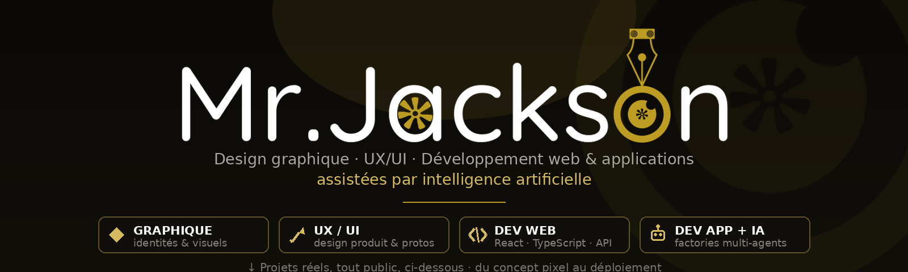

  

# Salut, moi c'est Mr Jackson 👋

**Designer graphique & UX/UI devenu développeur** — je conçois les produits
*et* je les construis. Ma particularité : je développe **assisté par
l'intelligence artificielle**, avec des chaînes multi-agents que j'ai
moi-même bâties pour passer du pixel au produit déployé, vite et bien.

> 🇬🇧 *Graphic & UX/UI designer turned developer — I design the product,
> then build it, with AI-assisted engineering pipelines I put together
> myself: from pixel to deployed product.*

  

---

## 🧭 Ce que je fais

| | Domaine | Concrètement |
|---|---|---|
| 🎨 | **Design graphique** | Identités visuelles, affiches, matériaux de communication, vectoriel & print-ready |
| ✏️ | **UX / UI design** | Maquettes, design systems, prototypes cliquables, accessibilité (WCAG AAA), dark & light modes |
| 🌐 | **Dev web** | React 19 + TypeScript, FastAPI, PostgreSQL, Docker, CI/CD — front et back, aucun pont à moitié fini |
| 🤖 | **Dev d'applications assisté par IA** | Apps desktop (Electron) & mobile (Jetpack Compose) construites par une usine logicielle multi-agents que j'avise, pilote et audit |

## 🚀 Projets en vitrine (réels, tout public)

| Projet | Pitch | Design? | Code? | Démo |
|---|---|---|---|---|
| 📡 [**Gestion-Wi-Fi**](https://github.com/Mr-Jacks0n/Gestion-Wi-Fi) — *Adven's Manager* | Vente & gestion de tickets Wi-Fi : caisse, Wave, FIFO vendeurs, audit immuable, PWA smartphone | ✅ | React TS + FastAPI | [🎮 démo en ligne](https://mr-jacks0n.github.io/Gestion-Wi-Fi/) |
| ⚡ [**LanceFer**](https://github.com/Mr-Jacks0n/LanceFer) — *LanceDrop* | Transfert de fichiers Android ↔ PC sans cloud, 51–70 Mo/s mesurés, reprise réseau, appairage QR | ✅ | Node + Electron + Compose | [💾 releases](https://github.com/Mr-Jacks0n/LanceFer/releases) |
| 🏋️ [**ivoire-gym-gestion**](https://github.com/Mr-Jacks0n/ivoire-gym-gestion) | Gestion d'un club fitness à Bouaké : QR HMAC, finances SYSCOHADA, RH & messagerie | ✅ | React 19 + Express | [🌐 site](https://ivoire-gym-gestion.onrender.com) |
| 🧠 [**IA**](https://github.com/Mr-Jacks0n/IA) — *ARIA* | Assistant personnel apprenant : règles, mémoire, réflexion, GUI tkinter | ✅ | Python | [⬇ repo](https://github.com/Mr-Jacks0n/IA) |
| 📉 [**simulation-maintenance-predictive**](https://github.com/Mr-Jacks0n/simulation-maintenance-predictive) | Maintenance prédictive hybride validée sur dataset NASA C-MAPSS (AUC 0.984) | ✅ | Python | [⬇ repo](https://github.com/Mr-Jacks0n/simulation-maintenance-predictive) |

> Chacun de ces projets a une vraie CI (tests automatisés, dont plusieurs
> suites adversariales), un README bilingue EN/FR et des chiffres
> **mesurés**, pas des promesses.

## 🧪 Ma méthode : le mieux des deux mondes

1. **Le design d'abord** — besoins réels, maquettes fidèles aux usages,
   tokens de design réutilisés telles quelles dans le code.
2. **L'IA comme chaîne de production** — mais *sous contrôle* :
   architectes, ingénieurs, QA, auditeurs sécurité et gatekeepers de
   release travaillent avec moi ; **chaque feature passe au veto d'audit**
   et des tests avant publication.
3. **La fiabilité du produit fini** — CI verte obligatoire, historique git
   propreté, releases signées par artefacts construits automatiquement.

## 🛠 Outils & stack

         

*(design : Figma, suites Adobe ; dev front : React/TS, Compose ; back :
FastAPI, Express, PostgreSQL, Redis, Docker ; desktop : Electron ;
mobile : Android Jetpack Compose ; IA : pipelines multi-agents, éval
humaine systématique.)*

## 📈 Stats GitHub

  <picture>
    <source media="(prefers-color-scheme: dark)"
      srcset="https://github-readme-stats.vercel.app/api?username=Mr-Jacks0n&show_icons=true&hide_border=true&bg_color=00000000&title_color=d6ba60&icon_color=bc9c22&text_color=92b5a5&ring_color=bc9c22&number_format=latin" />
    
  </picture>
  <picture>
    <source media="(prefers-color-scheme: dark)"
      srcset="https://github-readme-stats.vercel.app/api/top-langs/?username=Mr-Jacks0n&layout=compact&hide_border=true&bg_color=00000000&title_color=34d399&text_color=92b5a5&langs_count=8&exclude_repo=Ivoire-Gym-ges,mon-porfolio" />
    
  </picture>

## 📮 Me contacter

- 💬 Ouvert aux projets freelance et collaborations (design + intégration
  en une seule équipe, ou dev outillé IA pour livrer vite *sans sacrifier
  la robustesse*).
- 🖤 Profil à corriger ? Le [dépôt de votre profil](https://github.com/Mr-Jacks0n/Mr-Jacks0n) sert
  aussi d'espace d'échange — [ouvrez une issue](https://github.com/Mr-Jacks0n/Mr-Jacks0n/issues) 😄
- ⚡ Fun fact : chaque dépôt de ce profil a été conçu, maquetté, codé,
  testé puis relu… en binôme (honnête) avec l'IA — le design et le veto
  final restent humains.
